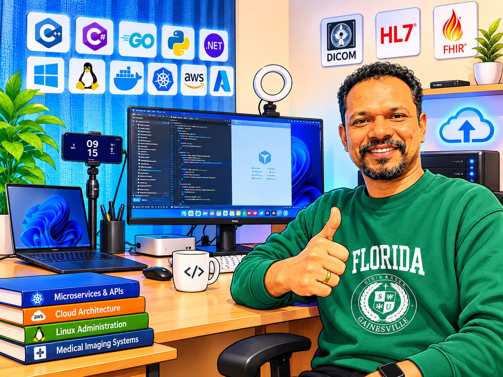
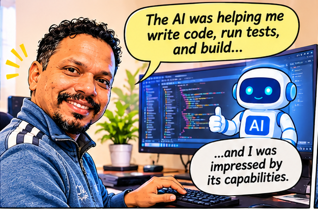
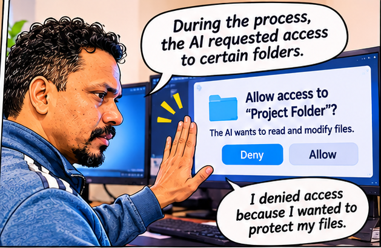
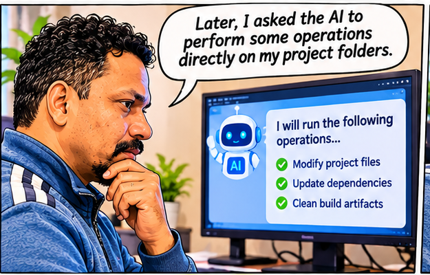
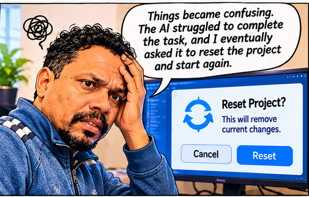
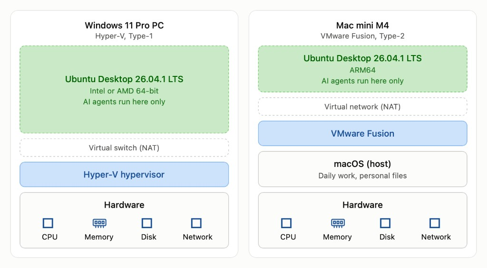

AI agents are amazing. They can write code, automate tasks, manage files, and significantly improve our productivity.

But are we using them safely?

Recently, I had a real experience that taught me an important lesson.

## 📖 The Story

<figure>
  
  <figcaption>Home work on the Mac Mini, where the AI coding experiment started.</figcaption>
</figure>

I was Home work on my Mac Mini, experimenting with an AI coding agent.

Initially, everything was smooth. The AI was helping me write code, run tests, and build, and I was impressed by its capabilities.

<figure>
  
  <figcaption>The AI was helping write code, run tests, and build.</figcaption>
</figure>

During the process, the AI requested access to certain folders. I denied access because I wanted to protect my files.

<figure>
  
  <figcaption>The AI requested folder access. Access was denied to protect the files.</figcaption>
</figure>

Later, I asked the AI to perform some operations directly on my project folders.

<figure>
  
  <figcaption>The AI was asked to work directly on the project folders.</figcaption>
</figure>

Things became confusing. The AI struggled to complete the task, and I eventually asked it to reset the project and start again.

<figure>
  
  <figcaption>After the AI struggled, the request was to reset the project and start again.</figcaption>
</figure>

Unfortunately, I didn't notice the implications of one confirmation prompt.

**The result? My project files and documents were deleted.**

<figure>
  
  <figcaption>One confirmation prompt deleted the project files and documents.</figcaption>
</figure>

It was a painful experience, especially because I was experimenting on my primary operating system.

<figure>
  
  <figcaption>The experiment was on the primary operating system, so the loss was painful.</figcaption>
</figure>

## 💡 What Did I Learn?

The problem wasn't simply the AI. It was also the environment in which I was using it.

AI agents can perform powerful operations, including deleting files, modifying configurations, and executing commands.

We should never assume that an AI agent will always understand our intentions correctly.

## 🛡️ My Solution: Use a Virtual Machine

Instead of experimenting directly on your primary operating system, consider creating an isolated development environment.

For example:

- **Mac:** VMware Fusion or another compatible virtualization solution running Ubuntu or Linux.
- **Windows:** Hyper-V with Ubuntu or another development OS.
- Take VM snapshots before major experiments.
- Keep personal files outside the VM.
- Avoid unnecessary shared folders and permissions.
- Maintain Git repositories and independent backups.

<figure>
  
  <figcaption>AI agents run only inside Ubuntu. On a Windows 11 Pro PC that VM sits on Hyper-V. On the Mac mini M4 it sits on VMware Fusion, and daily work stays on macOS.</figcaption>
</figure>

If something goes wrong, you can restore the VM snapshot and continue your experiments.

Remember, a VM is an additional layer of protection, not a complete security guarantee. Proper isolation and backups are still essential.

## 🚀 Final Thoughts

AI agents are transforming software development.

They can make us faster, more productive, and more creative.

But as AI capabilities increase, responsible usage becomes even more important.

**Give AI only the permissions it needs. Protect your data. Experiment in an isolated environment.**

AI is powerful — but being careful is even more powerful!

**Tags:** #AI #AIAgents #SoftwareDevelopment #VirtualMachine #CyberSecurity #DevOps #Automation #DeveloperExperience #MacMini
