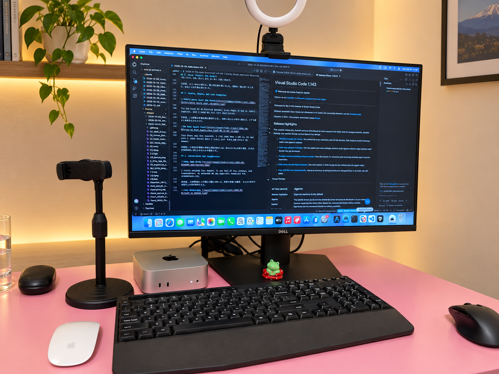
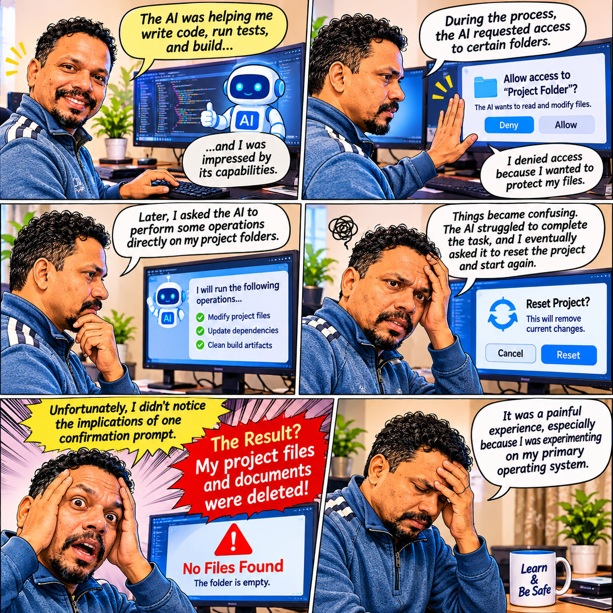
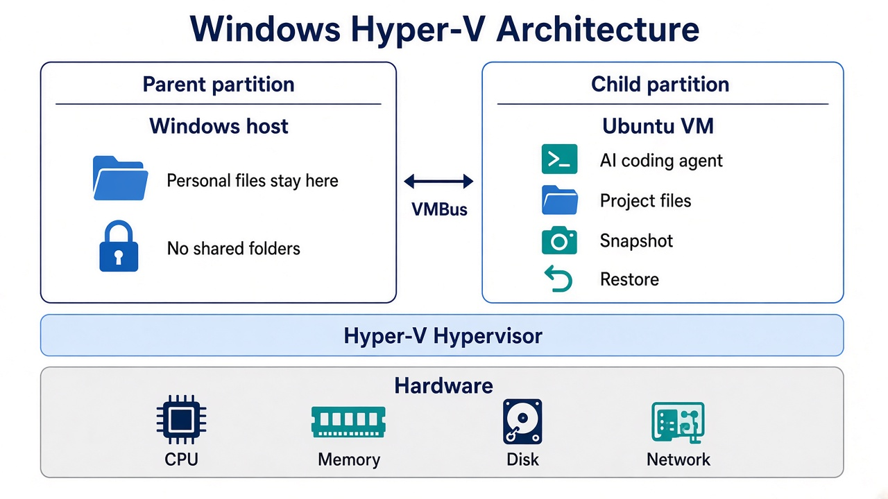

AI agents are amazing. They can write code, automate tasks, manage files, and significantly improve our productivity.

But are we using them safely?

Recently, I had a real experience that taught me an important lesson.

## 📖 The Story

<figure>
  
  <figcaption>Working from home on the Mac Mini, where the AI coding experiment started.</figcaption>
</figure>

I was working from home on my Mac Mini, experimenting with an AI coding agent.

<figure>
  
  <figcaption>The AI helped write code and run tests. A later reset confirmation deleted the project files.</figcaption>
</figure>

Initially, everything was smooth. The AI was helping me write code, run tests, and build, and I was impressed by its capabilities.

During the process, the AI requested access to certain folders. I denied access because I wanted to protect my files.

Later, I asked the AI to perform some operations directly on my project folders.

Things became confusing. The AI struggled to complete the task, and I eventually asked it to reset the project and start again.

Unfortunately, I didn't notice the implications of one confirmation prompt.

**The result? My project files and documents were deleted.**

It was a painful experience, especially because I was experimenting on my primary operating system.

## 💡 What Did I Learn?

The problem wasn't simply the AI. It was also the environment in which I was using it.

AI agents can perform powerful operations, including deleting files, modifying configurations, and executing commands.

We should never assume that an AI agent will always understand our intentions correctly.

## 🛡️ My Solution: Use a Virtual Machine

<figure>
  
  <figcaption>Experiment inside a virtual machine so a mistake can be restored instead of deleting files on the main computer.</figcaption>
</figure>

Instead of experimenting directly on your primary operating system, consider creating an isolated development environment.

For example:

- **Mac:** VMware Fusion or another compatible virtualization solution running Ubuntu or Linux.
- **Windows:** Hyper-V with Ubuntu or another development OS.
- Take VM snapshots before major experiments.
- Keep personal files outside the VM.
- Avoid unnecessary shared folders and permissions.
- Maintain Git repositories and independent backups.

<figure>
  
  <figcaption>On Windows, Hyper-V runs the Ubuntu VM beside the host, above the hypervisor. Personal files stay on the host.</figcaption>
</figure>

If something goes wrong, you can restore the VM snapshot and continue your experiments.

Remember, a VM is an additional layer of protection, not a complete security guarantee. Proper isolation and backups are still essential.

## 🚀 Final Thoughts

AI agents are transforming software development.

They can make us faster, more productive, and more creative.

But as AI capabilities increase, responsible usage becomes even more important.

**Give AI only the permissions it needs. Protect your data. Experiment in an isolated environment.**

AI is powerful — but being careful is even more powerful!

**Tags:** #AI #AIAgents #SoftwareDevelopment #VirtualMachine #CyberSecurity #DevOps #Automation #DeveloperExperience #MacMini
